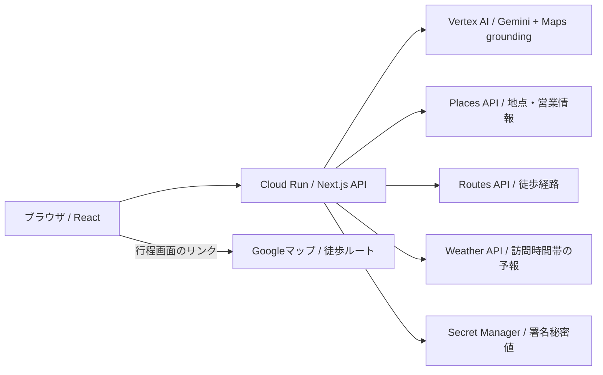

# よりみち

## チーム: AI-PUT(DF-2026-T151)

**暇なスキマ時間を、地域をよく知る時間へと変える。**

次の予定までの時間に、その土地を知る寄り道を提案する観光向けWebアプリです。
DevFest GDGoC Japan 2026 Hackathonの観光カテゴリ向けに開発しました。

**[アプリを開く](https://yorimichi-1044029411710.asia-northeast1.run.app/)** · **[位置情報の扱い](https://yorimichi-1044029411710.asia-northeast1.run.app/about#privacy)**

登録・ログインは不要です。対応する移動手段は徒歩のみです。

## 解決したい課題

旅行先で、ホテルのチェックインや待ち合わせまで少し時間ができても、周辺の場所を探し、営業時間や移動時間を確認して、次の予定に間に合うかを判断する必要があります。雨で予定が変わったときには、行き先を探し直す負担も生まれます。

「よりみち」は、目的地と到着希望日時を起点に、周辺の体験と時間の見通しをまとめて提示します。有名な観光地に加えて、知らなかった建物の見どころや小さな展示、店舗などに出会い、スキマ時間を地域を知る時間にすることを目指しています。

### テーマ「Own the Why, Build with Intent」との関連性

AIに任せる役割と検証基準を人間が定め、提案の採否を根拠に基づいて判断する設計に、テーマを反映しています。

- **AIの提案を別の情報・処理で検証する：** Geminiが提案した候補を、Places APIの施設・営業情報、Routes APIの移動時間、通常のプログラムによる到着期限の判定で検証します。AIの探索能力を活かしながら、人間が定めた条件で提案を評価します。
- **利用者が理由を持って選択する：** 最大3件の提案に体験内容・必要時間・出典・不明事項を示し、利用者が自分の予定や関心に合わせて選べるようにしています。判断材料を提示することで、利用者自身が納得して行動を決められる体験を目指します。

## 主な機能

| 機能                 | 内容                                                                                |
| -------------------- | ----------------------------------------------------------------------------------- |
| 地点・日時の指定     | 目的地と到着希望日時を指定。出発地点は現在地取得と手動指定に対応                    |
| 寄り道候補の探索     | GeminiとGoogle Mapsの情報から、出発地点の直線3km以内の体験候補を探索                |
| 体験の比較           | 最大3件のカードで、何ができるか・必要時間・出典を比較。横スワイプやボタンで切り替え |
| 時間・天候の評価     | 移動・待ち・体験・会計や退出・余裕時間と、訪問予定時間帯の予報を考慮                |
| 行程の確認           | 選んだ地点・体験を再検証し、寄り道先への到着・出発目安と目的地への到着見込みを表示  |
| 再計算・直行への変更 | 最新の地点・時刻で再計算し、寄り道をやめて直行する操作にも対応                      |
| 不明事項の案内       | 営業時間や利用条件の不明事項を表示し、確認済み情報と区別                            |
| Googleマップ連携     | 出発地点・寄り道先・目的地を渡し、Googleマップで徒歩経路を開く                      |

## 使い方・動作確認

1. [公開アプリ](https://yorimichi-1044029411710.asia-northeast1.run.app/)を開きます。
2. 目的地を検索し、候補から場所を選びます。
3. 到着希望日時を設定します。
4. 現在地を取得するか、出発地点を手動で指定します。
5. 「寄り道を探す」を押し、候補の体験内容・時間・注意事項を比較します。
6. 「行程を見る」を押して再検証し、移動順序と時刻の見込みを確認します。
7. 必要に応じてGoogleマップで徒歩経路を開くか、再計算・直行への変更を行います。

**確認用の入力例：** 出発地点「新宿駅」、目的地「新宿御苑」、到着希望日時は実行時刻から2〜3時間後。手動で出発地点を指定すれば、現地にいなくても試せます。

検索は実APIを利用します。時刻・営業情報・天候・生成結果によって候補数や内容は変わり、候補が出ない場合もあります。夜間などは条件を変更して試してください。架空の固定候補を表示するデモモードはありません。

## 仕組みと技術構成



Geminiが出典付きの候補を探索・構造化し、サーバーが地点と根拠の対応を照合します。施設情報はPlaces API、移動時間はRoutes API、予報はWeather APIで取得し、到着期限との比較は通常のプログラムで行います。選択後も同じ地点・体験を最新の時刻で再検証します。

| 使用技術                           | 使用箇所                 | 選定理由・メリット                                  | デメリット                           |
| ---------------------------------- | ------------------------ | --------------------------------------------------- | ------------------------------------ |
| Cloud Run                          | 画面・APIのホスティング  | 管理負担を抑え、アクセスがないときは0台に縮小できる | コールドスタートによる遅延がある     |
| Vertex AI / Gemini＋Maps grounding | 体験候補の探索・構造化   | 地点の事前登録なしで、周辺の候補を出典付きで探せる  | 生成内容の検証が必要                 |
| Places API                         | 地点・営業情報の取得     | 実在地点や営業状態・営業時間を確認できる            | 情報が欠ける場合がある               |
| Routes API                         | 徒歩の移動時間の取得     | 寄り道を含む移動時間を評価できる                    | 到着時刻は見積もりであり保証されない |
| Weather API                        | 訪問予定時間帯の予報取得 | 天候入力を省き、候補に反映できる                    | 予報の欠損・変化がある               |
| ADC / Secret Manager               | API認証・秘密値の管理    | 実行IDによる認証と秘密値の管理をまとめられる        | IAM権限や認証方式の理解・設定が必要  |

画面とAPIはTypeScript・Next.js・React・Tailwind CSS・Node.jsで構築しています。公開環境ではGoogle APIへの認証にCloud Runの実行IDによるADCを使用し、Google APIキーを参照しません。署名用秘密値はSecret Managerで管理します。コンテナのビルド・保存にはCloud BuildとArtifact Registryを使います。

## 現在の対応範囲と制約

- **対応する移動手段：** 徒歩のみです。探索距離3kmは直線距離であり、徒歩経路の距離ではありません。
- **外観観察を1件含む構成：** 有効な外観候補を先頭に置き、飲食・館内体験などと合わせて最大3件を返します。外観候補が成立しない場合は、屋内案だけの提案は返しません。
- **時間は推定：** 体験・待ち時間にはカテゴリ別の推定値を使い、余裕時間は10分を確保します。混雑の実測や到着保証には対応していません。
- **不明情報を明示：** 営業状態や利用条件が不明な候補は暫定候補として表示します。閉業・営業時間外など利用不可が確認された場合や、時間・経路・天候の条件が成立しない場合は除外します。
- **利用回数制限あり：** Cookie識別子とプロセス内のカウンターを使用します。再起動・複数インスタンスでは回数を共有せず、Cookieのリセットでも回避され得ます。詳細と現在の上限は[API呼び出し制限](docs/API呼び出し制限.md)を参照してください。
- **Googleマップ側で再計算：** 外部地図へは地点を渡します。アプリの体験時間・余裕時間・到着期限は引き継がれません。

現在地はユーザー操作に応じて取得し、継続的な位置追跡は行いません。Googleへの送信内容や保存については[位置情報の扱い](https://yorimichi-1044029411710.asia-northeast1.run.app/about#privacy)を参照してください。

## ローカルでの起動

共通開発環境はDocker Composeです。ローカルで実APIを使うには、Google Cloudの請求設定、Places API (New)・Routes API・Weather API・Vertex AI APIの有効化、実行する認証主体への権限設定が必要です。

1. リポジトリを取得します。

    ```sh
    git clone https://github.com/Devfest-Hackathon-2026/df-2026-t151.git
    cd df-2026-t151
    ```

2. [`.env.example`](.env.example)を`.env.local`へコピーし、以下を設定します。

    | 変数                    | 設定内容                                                          |
    | ----------------------- | ----------------------------------------------------------------- |
    | `GOOGLE_CLOUD_PROJECT`  | 利用するGoogle CloudプロジェクトID                                |
    | `GOOGLE_CLOUD_LOCATION` | Vertex AIのロケーション。既定は`global`                           |
    | `GOOGLE_MAPS_AUTH_MODE` | `service-account`またはローカル用の`api-key`                      |
    | `GOOGLE_MAPS_API_KEY`   | Mapsを`api-key`方式で使う場合のみ設定                             |
    | `OPTION_TOKEN_SECRET`   | 候補・Cookieの署名用秘密値。32〜256文字の空白を含まない乱数文字列 |

3. Vertex AI用のADCを準備します。Mapsを`service-account`方式で使う場合もADCを利用します。Dockerでは、リポジトリ外のADCファイルをコンテナへ読み取り専用でマウントし、コンテナ内の`GOOGLE_APPLICATION_CREDENTIALS`にそのパスを指定してください。準備方法は[Vertex AI認証設定](docs/VertexAI認証設定.md)と[Maps認証設定](docs/Maps認証設定.md)を参照してください。
4. Docker Desktopを起動し、リポジトリのルートで実行します。

    ```sh
    docker compose up --build
    ```

5. [http://localhost:3000](http://localhost:3000)を開きます。

Vertex AIは常にADCで認証し、`GEMINI_API_KEY`は使用しません。画面は認証設定が不足している場合も開けますが、実検索には設定が必要です。認証情報はサーバー側だけで扱い、`.env.local`やADCファイルはGitへ追加しないでください。

Dockerを使わない場合は、[`.nvmrc`](.nvmrc)で指定したNode.js 24.22.2とホスト側のADCを準備し、`npm ci`、`npm run dev`の順で起動できます。詳細は[開発環境](docs/開発環境.md)を参照してください。

## テストと検証

起動中のComposeコンテナで、次のコマンドを実行できます。自動テストは外部APIを差し替えており、実際のGoogle APIを呼びません。

```sh
docker compose exec app npm test
docker compose exec app npm run typecheck
docker compose exec app npm run format:check
docker compose exec -e NODE_ENV=production app npm run build
```

2026年11月10日の提出向け公開時点で、Node.js 24.22.2のDocker環境における自動テスト459件・本番ビルド・型チェック・整形チェックの成功を記録しています。同じ公開リビジョンの検証用URLでは、実APIの候補検索・天候取得・選択後の同一地点と体験の再検証を確認しました。

最新公開版の実ブラウザでの全操作、GPS許可操作、スマートフォン実機、現地での移動・滞在時間は、この公開記録では未確認です。実施済みの確認と未確認の範囲は[検証結果](docs/検証結果.md)と[Cloud Run公開記録](docs/CloudRun公開手順.md)に記載しています。

## 今後の展望

- 公共交通機関・自転車・自動車への対応と、乗り換え・駐輪・駐車時間を含む行程の評価。
- 現地検証、利用者の口コミ、店舗からの情報提供による体験時間の補正。
- Firestore等による利用者別・全体のAPI利用回数の共有管理と、利用者識別方法の見直し。
- 地域イベント情報や店舗オーナーによる情報登録を通じた、観光体験の充実。

## 開発・設計資料

| 資料                                                         | 内容                                       |
| ------------------------------------------------------------ | ------------------------------------------ |
| [ドキュメント一覧](docs/README.md)                           | 設計・開発・運用資料への入口               |
| [要件定義](docs/よりみち要件定義書.md)                       | 対象ユーザー、機能、時間計算、受け入れ条件 |
| [API入出力仕様](docs/API入出力仕様.md)                       | 画面とサーバー間の入出力・エラー形式       |
| [コード構成と保守ガイド](docs/コード構成と保守ガイド.md)     | 各処理の責務と変更時の確認箇所             |
| [拡張性と設計](docs/拡張性と設計.md)                         | 拡張時の境界と制約                         |
| [候補の不明情報と除外理由](docs/候補の不明情報と除外理由.md) | 暫定候補・不明表示・除外の方針             |
| [開発環境](docs/開発環境.md)                                 | Docker・依存関係・開発手順                 |
| [Cloud Run公開記録](docs/CloudRun公開手順.md)                | 公開設定と実接続の検証履歴                 |
| [GitHub運用ルール](docs/GitHub運用ルール.md)                 | ブランチ・PR・レビューの進め方             |

開発ではAIコーディング支援を使い、目的・機能範囲・技術の採否はチームで判断しました。AIによる候補探索と、通常のプログラムによる条件検証を分担しています。テスト用の架空データは`fixtures/`に置き、公開アプリの実検索には使用しません。
